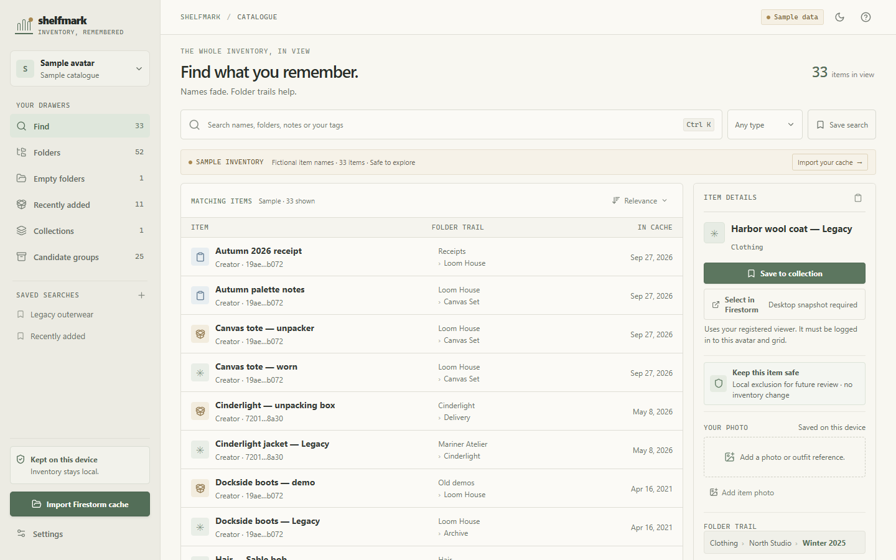

# Shelfmark

<p align="center">
  <a href="https://nowalski.github.io/Shelfmark_sl/">
    
  </a>
</p>

<p align="center">
  <strong>A desktop app for your Second Life inventory.</strong><br>
  Search your Firestorm snapshot, keep notes and tags, and send selected items to Trash on Windows.
</p>

<p align="center">
  <a href="https://github.com/Nowalski/Shelfmark_sl/releases/latest"></a>
  <a href="https://github.com/Nowalski/Shelfmark_sl/releases"></a>
  <a href="https://github.com/Nowalski/Shelfmark_sl/actions/workflows/build.yml"></a>
  <a href="https://github.com/Nowalski/Shelfmark_sl/actions/workflows/firestorm-mini.yml"></a>
  <a href="LICENSE"></a>
</p>

<p align="center">
  <a href="https://nowalski.github.io/Shelfmark_sl/">Project page</a> ·
  <a href="docs/USER_GUIDE.md">User guide</a> ·
  <a href="docs/FAQ.md">FAQ</a> ·
  <a href="docs/FIRESTORM.md">Firestorm notes</a> ·
  <a href="docs/BUILDING.md">Build from source</a>
</p>

Shelfmark reads a Firestorm inventory snapshot and builds a searchable catalogue on your computer. On Windows, you can connect Firestorm and move a selected item to Trash without leaving Shelfmark. The optional Firestorm Mini viewer adds a direct, confirmed route for a single-item Trash move.

## Download and start

Download Shelfmark for your platform from [GitHub Releases](https://github.com/Nowalski/Shelfmark_sl/releases/latest). To move items to Trash from the packaged Windows app, also install the [experimental Firestorm Mini viewer](https://github.com/Nowalski/Shelfmark_sl/releases/tag/firestorm-mini-7.2.5.81788). It can sit alongside stock Firestorm, but has no sound or voice. Open Shelfmark, choose **Import Firestorm cache**, select the avatar snapshot you want, and confirm. Shelfmark checks common cache locations; choose **Browse** if yours is elsewhere.

For the newest snapshot, close Firestorm before importing or refreshing so the viewer has a chance to save its cache. See the [user guide](docs/USER_GUIDE.md) for the full walkthrough.

## What Shelfmark does

- **Find items:** search names, descriptions, folder paths, and your local tags; sort by name or recent cache timestamps.
- **Review your catalogue:** browse the original folder tree, filter by item type, look through empty folders, and inspect candidate groups such as possible duplicates or packages. These groups are clues, not verdicts.
- **Keep your own context:** add private notes and tags, save searches, mark items or folders to revisit, and make collections with reference photos.
- **Move an item to Trash:** on Windows, use the experimental Firestorm Mini build on the Second Life main grid. Firestorm asks you to confirm each move, and Shelfmark checks the live folder before updating its catalogue. Moving items to other folders remains paused; do that in Firestorm.
- **Use a local catalogue on other platforms:** Windows, macOS, and Linux builds can import and browse snapshots. Live Firestorm connection and Trash actions are currently Windows-only.

## Your data stays on your device

Shelfmark reads the Firestorm cache you select. It does not send your inventory, notes, tags, or photos to a Shelfmark service, and it never asks for your Second Life password. The cache file is read-only. The desktop app contacts GitHub Releases to check for signed updates; see [privacy and local data](docs/USER_GUIDE.md#updates-and-local-data).

Keep Firestorm’s **All Items** inventory tab open and clear its inventory search before a Trash action. When you are done, close Firestorm and refresh the snapshot to sync its saved cache. Read the [Firestorm notes](docs/FIRESTORM.md) before using live actions.

## Platform support

| Platform | Local catalogue | Firestorm Trash actions |
| --- | --- | --- |
| Windows | Import, search, review, and organise snapshots | Experimental Firestorm Mini viewer for confirmed one-item Trash moves on the Second Life main grid |
| macOS | Import, search, review, and organise snapshots | Not currently available |
| Linux | Import, search, review, and organise snapshots | Not currently available |

The browser preview (`npm run dev`) uses fictional sample data. It cannot read local files or connect to Firestorm.

## Build from source

Install [Node.js 22](https://nodejs.org/), Rust stable, and the [Tauri v2 prerequisites](https://v2.tauri.app/start/prerequisites/) for your platform. Then run:

```sh
npm ci
npm run desktop:dev
```

For packaging and updater releases, see [Build and release](docs/BUILDING.md).

## Terms of use

Shelfmark is source-available under personal-use terms; it is **not an OSI-approved open-source project**. The license allows personal, non-commercial use and private modifications. It does not grant permission to sell the app, distribute copies outside GitHub, rebrand it, or present it as your own. Because this is a public GitHub repository, viewing and forking on GitHub is also subject to [GitHub’s terms](https://docs.github.com/en/site-policy/github-terms/github-terms-of-service). Read [LICENSE](LICENSE) before using Shelfmark. The Firestorm Mini viewer and source patch are separate Firestorm-derived components under LGPL-2.1-only; that license does not apply to Shelfmark itself. See the [viewer notes](integrations/firestorm-mini/README.md).

## Help and project links

- [User guide](docs/USER_GUIDE.md)
- [FAQ](docs/FAQ.md)
- [Firestorm compatibility and Trash actions](docs/FIRESTORM.md)
- [Build and release](docs/BUILDING.md)
- [Changelog](CHANGELOG.md)
- [Contributing guidelines](CONTRIBUTING.md)
- [Report a problem](https://github.com/Nowalski/Shelfmark_sl/issues)
- [Report a security issue privately](https://github.com/Nowalski/Shelfmark_sl/security/advisories/new)

Shelfmark is independent software and is not affiliated with Linden Lab or the Firestorm team. Second Life and Firestorm are trademarks of their respective owners.
